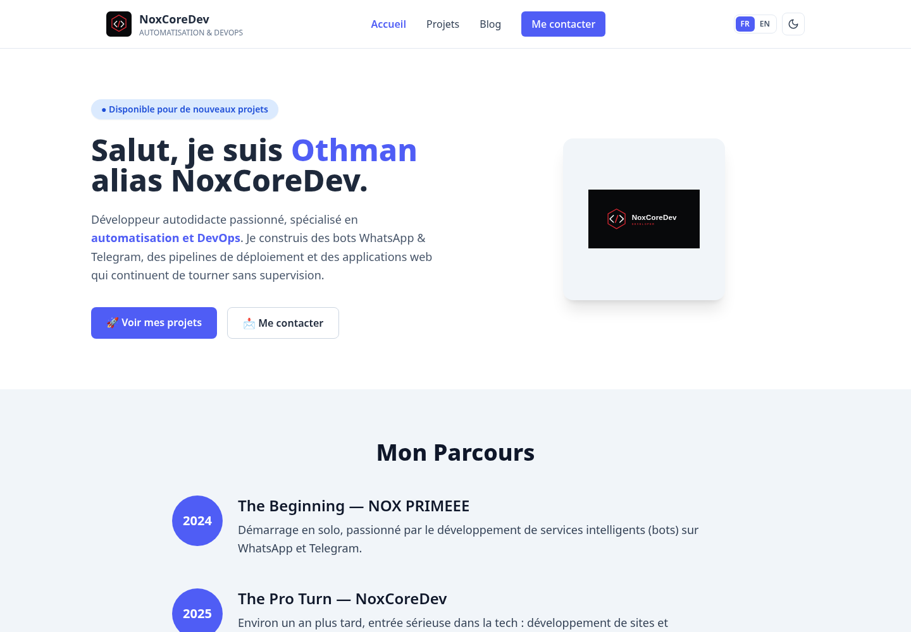
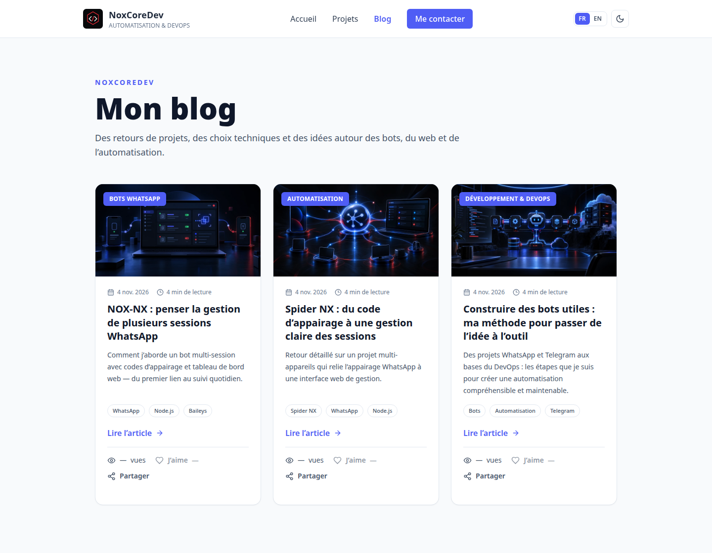

# NoxCoreDev — Portfolio Full-Stack

Portfolio bilingue (français/anglais) d’Othman, alias **NoxCoreDev**. Le dépôt est public et le code de ce projet est distribué sous licence MIT : vous pouvez le cloner, le personnaliser et l’utiliser comme base pour votre propre portfolio, en conservant les avis de licence et d’attribution.

<p align="center">
  <a href="https://noxcoredev-portfolio.vercel.app"><strong>Voir le portfolio en ligne</strong></a>
  ·
  <a href="https://github.com/NoxCoreDev/NoxCoreDev-Profile/fork"><strong>Créer votre fork</strong></a>
</p>

<p align="center">
  <a href="LICENSE"></a>
  <a href="https://react.dev"></a>
  <a href="https://vite.dev"></a>
</p>

## Aperçu

Les captures ci-dessous sont générées à partir des pages du site et conservées dans le dépôt pour que les développeurs puissent voir le résultat avant de le cloner.

| Accueil et présentation Full-Stack | Blog technique |
|:--:|:--:|
|  |  |

## Fonctionnalités

- **Présentation Full-Stack** : compétences frontend et backend, parcours et projets.
- **Animations déjà présentes** : révélations au défilement avec ScrollReveal et transitions au survol sur les cartes, boutons et liens.
- **Français et anglais**, avec préférences de langue et de thème clair/sombre enregistrées dans le navigateur.
- **Pages projet et blog** avec articles localisés, images de partage générées au build, partage natif et interactions J’aime/vues.
- **API serverless** pour les statistiques des articles, conçue pour Vercel ou un hébergeur compatible avec les fonctions Node.js.
- **Pages Contact et mentions légales**, ainsi que politique de confidentialité et conditions d’utilisation.
- **SEO de base** : URL canonique, Open Graph, carte X/Twitter, sitemap et données structurées.
- **Mise en page responsive** adaptée aux téléphones et aux grands écrans.

## Technologies

**Interface :** React 18, Vite 5, React Router, Tailwind CSS, Lucide, React Icons et ScrollReveal.

**Fonction côté serveur facultative :** fonction Node.js dans `api/` et compteurs Redis REST Upstash. Le site reste consultable sans cette configuration ; les statistiques ne sont alors pas affichées comme si elles existaient.

## Démarrage local

Prérequis : Node.js 18 ou une version ultérieure et npm.

```bash
git clone https://github.com/NoxCoreDev/NoxCoreDev-Profile.git
cd NoxCoreDev-Profile
npm install
npm run dev
```

Ouvrez l’adresse affichée par Vite, généralement `http://localhost:5173`.

Pour vérifier une version de production :

```bash
npm run build
npm run preview
```

## Activer les compteurs d’articles (facultatif)

Pour utiliser les boutons de vues et de J’aime, créez une base Redis compatible REST sur Upstash puis configurez ces variables dans l’environnement **serveur** de votre déploiement :

```env
UPSTASH_REDIS_REST_URL=
UPSTASH_REDIS_REST_TOKEN=
SITE_URL=https://votre-domaine.example
```

Un exemple est fourni dans `.env.example`. N’ajoutez jamais le jeton Redis à une variable `VITE_*` : elle serait incluse dans les fichiers publics du navigateur. Sans les deux variables Upstash, les compteurs restent indisponibles plutôt que d’afficher des chiffres fictifs. Les vues sont limitées à une par navigateur et par article sur 24 heures ; le J’aime peut être retiré.

## Personnaliser ce portfolio

1. Faites un **fork** du dépôt, puis clonez votre fork.
2. Remplacez le logo et les images dans `public/` par vos propres créations ou des ressources que vous avez le droit d’utiliser.
3. Modifiez `src/data/projects.js` pour ajouter vos projets, leurs descriptions, images, démonstrations et dépôts.
4. Personnalisez `src/i18n/translations.js`, `src/components/Hero.jsx` et `src/components/Parcours.jsx` pour votre profil. Les textes français et anglais sont gérés séparément.
5. Mettez à jour les liens sociaux dans `src/components/Footer.jsx`, les métadonnées et l’URL canonique dans `index.html`, ainsi que `public/og-image.png`, `public/sitemap.xml` et `public/robot.txt` pour votre domaine.
6. Si vous gardez le blog, ajoutez les articles dans `src/data/articles.jsx` et leurs slugs dans `src/data/article-slugs.json`. La commande de build génère les pages et aperçus associés.
7. Lancez `npm run build`, vérifiez le résultat avec `npm run preview`, puis déployez votre fork sur une plateforme statique. Vercel est déjà configuré ; les compteurs demandent en plus ses fonctions Node.js et les variables Upstash.

### Générer ou remplacer les captures du README

Les images utilisées dans ce README se trouvent dans `docs/screenshots/`. Remplacez-les par des captures de votre propre site lorsque vous changez fortement le design, en évitant d’y afficher des informations privées.

## Structure du dépôt

```text
api/
  article-stats.js           API de vues et de J’aime (Redis REST facultatif)
docs/screenshots/            Captures de l’accueil et du blog
public/
  blog/                      Couvertures d’articles
  icons/skills/              Icônes Devicon et leur licence
  logo.svg                   Logo principal
  og/                        Images de partage des articles
scripts/
  generate-article-previews.mjs
src/
  components/                Navigation, héros, compétences, projets et pied de page
  data/                      Projets, articles et slugs
  i18n/translations.js       Textes français et anglais
  pages/                     Accueil, projets, blog, articles et pages légales
  context/                   Préférences de thème et de langue
```

## Liens publics

- **Portfolio :** [noxcoredev-portfolio.vercel.app](https://noxcoredev-portfolio.vercel.app)
- **GitHub :** [github.com/NoxCoreDev](https://github.com/NoxCoreDev)
- **Email :** [devnoxinc@gmail.com](mailto:devnoxinc@gmail.com)
- **Telegram :** [@Noxmodai](https://t.me/Noxmodai)
- **WhatsApp :** [+224 623 75 29 38](https://wa.me/224623752938)
- **LinkedIn :** [NoxCoreDev](https://www.linkedin.com/in/NoxCoreDev)
- **X :** [@NoxPrimeeeinc](https://www.x.com/NoxPrimeeeinc)
- **Instagram :** [@noxprimeeeinc](https://www.instagram.com/noxprimeeeinc?vrfl=NmM3ZWFsd2t3cXdm)
- **YouTube :** [@noxcoredev](https://youtube.com/@noxcoredev?si=YGqUJHTXHkSHr8lm)
- **Facebook :** [Profil Facebook](https://www.facebook.com/share/1VZrh6qJQD)

## Licence et attributions

Le code de ce dépôt est sous **licence MIT** (voir [`LICENSE`](LICENSE)). Vous pouvez créer votre propre version et la redistribuer en conservant l’avis de copyright et le texte de licence. Le projet réutilise une base attribuée à **JeanStephTech** sous MIT ; les icônes de compétences proviennent de **Devicon** sous MIT. Les crédits détaillés sont dans [`NOTICE.md`](NOTICE.md) et doivent rester avec les fichiers concernés.

Les noms et logos de technologies restent la propriété de leurs détenteurs. Remplacez les photos, captures de projets et contenus qui ne vous appartiennent pas avant de publier votre propre portfolio ; une licence logicielle ne vous transfère pas automatiquement les droits sur ces médias ou sur des contenus tiers. La valeur `"private": true` de `package.json` empêche seulement la publication accidentelle du package sur npm ; elle ne rend pas ce dépôt GitHub privé.
